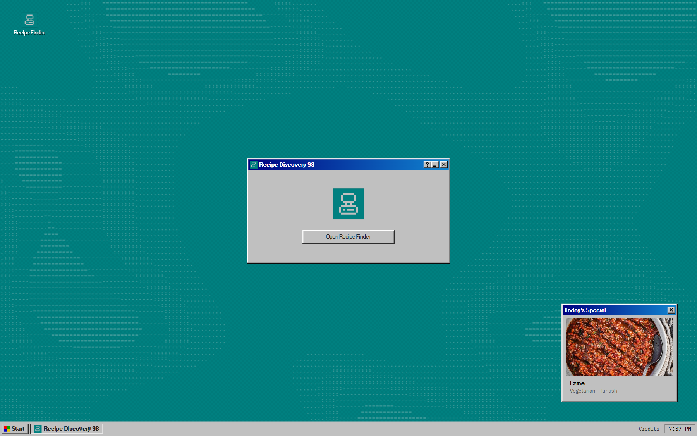
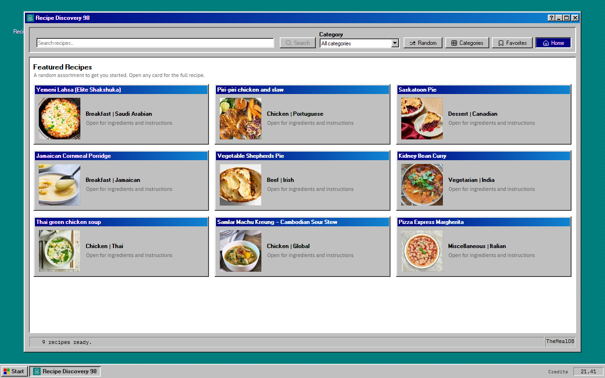
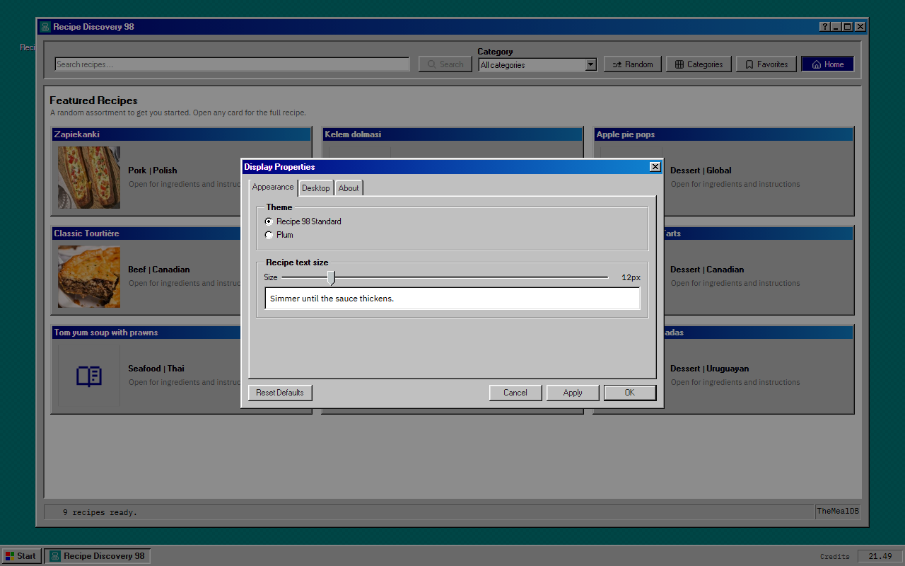

# Recipe Discovery 98

A Windows 98–styled recipe browser. Built as a personal experiment with React, TypeScript, Vite, 98.css, Asciify, Pixelarticons, IBM Plex, and TheMealDB.

**Demo:** https://auzanps.github.io/Recipe-98/







## Run

```bash
npm install
npm run dev
```

```bash
npm run build
npm test
npm run lint
```

Node `24+` LTS. The dev server runs at `http://localhost:3000/`.

## Features

- Search, categories, random recipes, favourites, and printable recipes
- A Windows 98 desktop with a draggable recipe window, taskbar, clock, and Start menu
- Welcome launcher on startup, then a program launch animation before the Recipe Finder opens
- Minimize, maximize, restore, and close window modes
- Display Properties with theme, recipe text size, desktop toggles, and 98.css tabs, fieldsets, tree view, table view, and slider
- Plum theme across title bars, dialogs, active controls, selections, and window accents via Display Properties or the Konami code

## Deploy

The app builds for the domain root by default, which is what Cloudflare Pages needs (for example `recipe98.auzan.dev`): build command `npm run build`, output directory `dist`, Node `24`. The `_headers` and `_redirects` files in `public/` set the security headers and the single-page-app fallback.

GitHub Pages serves the repo from a sub-path, so its workflow builds with `VITE_BASE_PATH=/Recipe-98/`.

## Credits

Everything is open source: 98.css (MIT), Asciify (MIT), Pixelarticons (MIT), IBM Plex (OFL-1.1), React (MIT), TanStack Query (MIT), Zod (MIT), Vite (MIT), Vitest (MIT).

Windows 98 reference: [98.css documentation](https://jdan.github.io/98.css/) · [Windows 98 interface gallery](https://guidebookgallery.org/screenshots/win98).

Recipe data and images belong to [TheMealDB](https://www.themealdb.com/). Windows 98 is a Microsoft trademark; this is an independent tribute, not affiliated with Microsoft. Project code is MIT licensed.
